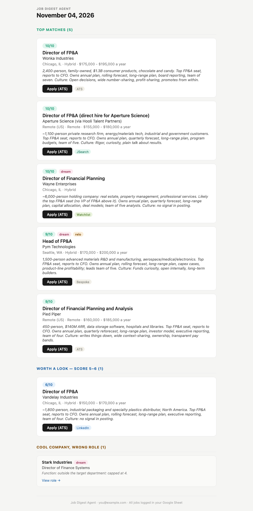
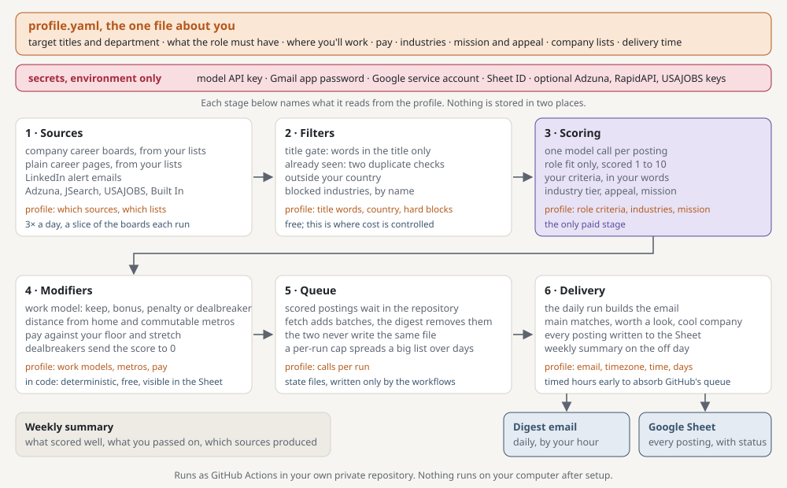

# Job Digest Agent

**Get an email with jobs worth your time, so you never have to look for openings.**

A job search agent that runs on your own GitHub account and emails you one ranked digest of job postings every morning. It reads company career boards directly, plus aggregators, LinkedIn alert emails and USAJOBS; scores every posting against a profile you build in a short interview; adjusts for where the job is and what it pays; and logs everything to a Google Sheet. It never applies to anything and never contacts anyone.



*A digest built from sample postings for an example profile. The real one looks the same with your roles in it.*

## What you get

- One email a day, on the days you choose, by the time you choose: the roles that fit you best, each with a score out of 10, the reasons, the stated pay, the location and work model, and a direct apply link where one exists.
- A Google Sheet with every posting the agent saw, its score and rationale, and a status column you can use to track where you applied.
- A weekly summary: what scored well, what you passed on, which sources produced.
- Optional: the agent reads your inbox for application-status emails and updates the Sheet (off by default; you choose).

## How it works



Postings are fetched three times a day, a slice of the boards each run, so every board is read at least daily without long runs. Cheap filters (title gate, already seen, country, blocked industries) decide what is worth a model call; that is where cost is controlled. One model call scores each remaining posting for role fit, modifiers in code adjust for work model, distance and pay, and the daily run emails the digest and writes the Sheet. The visual walkthrough at **[the project page](https://stephareno.github.io/jobdigest-open/)** has the same diagram with the sample digest and the setup phases.

Three separate parts, and nothing is stored in two of them: `profile.yaml`, your secrets, and the code. Everything about you lives in `profile.yaml`: the titles and department you want, what the role must have and must not, where you will work, what you need to be paid, which industries are in and out, how much mission and culture matter, your dream companies, and when the email should arrive. Secrets live only in your `.env` file and GitHub secrets. The code is the engine and does not change from person to person. `docs/PRD.md` is the full description of the rules.

## Setup

This project is designed to be set up with an AI assistant. You do not need coding experience.

1. On this repository's GitHub page, click the green **Use this template** button (next to **Code**), choose **Create a new repository**, and make it private. Not Fork: a template copy has a clean history and no link back here, and GitHub Actions will run in your repository with your secrets. The agent refuses to run in a public repository or a fork, because every run commits your profile and job history to it. Your copy's scheduled workflows start out active; [the setup guide](docs/SETUP_GUIDE.md)'s first phase turns them off until your keys are in place.
2. Open your new repository in a coding agent such as Claude Code or Codex, or start a chat with Claude or ChatGPT and attach three files from it: `README.md`, [`docs/PRD.md`](docs/PRD.md) and [`docs/SETUP_GUIDE.md`](docs/SETUP_GUIDE.md).
3. Say "help me set this up". The assistant walks you through five phases: GitHub setup, accounts and keys, an interview about the roles you want that becomes your `profile.yaml`, calibration on real postings, and a dry run. Plan on 60 to 90 minutes if you have none of the accounts, 20 if you have most.

Every phase ends with `python main.py doctor`, which checks what has been set up so far, so you can stop and come back later. The guide also covers doing it by hand from the terminal if you prefer. To install by hand, `pip install -r requirements.txt` in a virtual environment; `requirements.lock` holds the same pins with hashes, and it is what the workflows and CI install.

## What you need

- A GitHub account (free). The agent runs as GitHub Actions in a private repository you own.
- A Gmail account to send from, and a Google account for the Sheet.
- An API key for the scoring model. Today that is an Anthropic key (Claude); see the note under Cost. A few dollars a month at typical volume.
- Python 3.11 or later on your computer for setup.
- Optional, strongly recommended: a curated list of companies in your field. The agent reads company career boards directly, which is its best source, but it can only read boards it knows about. A starter list ships with the repository; the setup guide covers where to find more.
- Optional, strongly recommended: free Adzuna and RapidAPI (JSearch) keys for aggregator coverage, a free USAJOBS key for federal roles, and LinkedIn job alerts filed under a Gmail label.

## Where postings come from

| Source | Needs | Notes |
|---|---|---|
| Company career boards on Greenhouse, Lever, Ashby, SmartRecruiters, Workable, Rippling, Recruitee, BambooHR, Breezy, Teamtailor, Personio, Oracle HCM, ADP, UKG Ready, Gem, Comeet, Manatal, JobScore and Workday | a list of companies | The best source: fresh, complete, direct apply links |
| Plain career pages with no board | a list of companies | A slower crawler reads each page and has the model extract new postings when it changes. The first read of each page is a model call, so keep this to companies you care about |
| LinkedIn job alerts | a Gmail label | Reads the job-alert emails LinkedIn sends you from one Gmail label. Opening each job's public page to read the description is a separate switch, off by default: LinkedIn's user agreement prohibits automated access to its site and it blocks many such requests, so turn it on only if you accept that; off, jobs are scored from the alert alone and marked 'title only'. |
| Adzuna, JSearch | free keys | Wide but noisier; apply links go through an intermediary |
| USAJOBS | free key | US federal roles by job series |
| Built In | nothing | Tech roles in a handful of metros |

The repository ships one starter list: about 4,700 US public companies from SEC filings plus a few thousand startups and growth-stage technology companies, with their career boards already located. It is a snapshot, not maintained for you, and you should filter it to your industries and regions, both for cost and so the digest is about your field. The setup guide spends time on where to get lists for your field, because the agent can only read boards it knows about.

**Known gap.** Some large employers use systems the agent cannot read yet: iCIMS, SuccessFactors, Phenom, ClearCompany, Pinpoint, and career pages that only render with JavaScript. Roles at those companies reach you only through an aggregator or a LinkedIn alert.

## Cost

- Model API: about $4 to $11 a month at a typical 20 to 60 scored postings a day, a little over half a cent a posting (the scoring prompt is cached between calls). Conservative high: about $24 in the first month if you load the entire starter list unfiltered, because every board's existing postings get scored once; a daily ceiling on model calls spreads that over the first weeks, and after that it settles to the typical range.
- GitHub Actions: three short fetch runs and one digest run a day; within the free tier for a private repository.
- Adzuna, RapidAPI's free tier, USAJOBS, Gmail and Google Sheets: free at this volume.

`python main.py calibrate` prints the measured cost per call for your profile and model, and `profile.yaml` has a per-run cap on scoring calls so a large new company list cannot produce a surprise bill.

**About the model.** The agent was built and calibrated on Claude through the Anthropic API, and that is what it requires today. Every model call goes through one module, so adding another provider is a contained change; support for OpenAI-compatible endpoints is the first item on the public roadmap. If you want to use another provider before then, that module is where to start, and the setup guide's calibration step is how to check the scores still make sense.

## Limits

- Built and tested for the United States. The location model uses an offline US places file; another country needs that file rebuilt from GeoNames (`tools/build_us_places.py` is the starting point) and has not been tried.
- Delivery time depends on GitHub's scheduled-run queue, which on free-tier repositories routinely adds two to four hours. The schedule is set early enough that most digests arrive on time, not all.
- No source that requires a login. LinkedIn is covered through its alert emails.

## Privacy and data

Everything runs in your own GitHub repository and on your own computer; there is no server, analytics or telemetry of this project's. What leaves it:

- **To the model provider (Anthropic):** your profile's scoring text and each posting's text, once per posting scored. Also: text from the website of each company on a digest card (to rewrite its blurb), careers-page text when the bespoke crawler sees a page change, once a week the notes you wrote on rows you marked Declined, and, if you use `setup --from-document`, the resume or job description you give it.
- **Your own accounts:** the Google Sheet is yours, written through a service account you create. Gmail is yours: the digest is sent from it to you, and the LinkedIn reader opens one label you name, read-only, for alert emails from at least the last 7 days, and, if page fetching is on, LinkedIn receives requests for each job page from the runner's address.
- **Status tracking, off by default:** once a day it opens your inbox read-only and reads each message from the last 14 days, skipping mail sent from your own address. Only a message whose subject or body names a company that has a row on the main tab of your Sheet goes to the model: its sender, date, subject and body (up to 20,000 characters, links cut to their host), with up to 30 matching rows (company, title, status). No other message is sent. The model's replies are cached in `status_email_cache.json` in your repository.
- **Index Doc, off by default:** each entry of your applications Doc goes to the model to read the company, title and date.
- **Job sources:** the searches you configure (titles, places) go to the sources you turn on: Adzuna, JSearch, Built In and USAJOBS, which requires your Gmail address as its User-Agent. Company career boards are read directly.

Nothing is sent anywhere else.

## Repository map

```
main.py             commands: fetch, digest, doctor, setup, calibrate, resolve, cron, sheet-init
profile.yaml        your profile (you create it; profile.example.yaml is the commented template)
prompts/            the scoring and summary prompts, rendered from the profile
sources/            one module per source
location.py         distance tiers from the places file
comp.py             compensation modifier
scorer.py           the scoring call
emailer.py          the digest
sheets.py           the Google Sheet
data/company_lists/ shipped and personal company lists
data/us_places.tsv.gz  offline places (GeoNames)
docs/               PRD.md and SETUP_GUIDE.md; index.html (the project page) and assets/ (its images)
examples/postings/  twelve sample postings for calibrate --dir
tests/              1,100+ tests; run with pytest
.github/workflows/  fetch (3x daily), daily digest, weekly summary, monthly resolve
ROADMAP.md          a simple way to track changes you make (optional)
AGENTS.md           the brief for any coding agent working on this code
```

## Changing things later

Edit `profile.yaml` (every field is commented), run `python main.py profile-check`, commit and push. Timezone or digest time changed: `python main.py cron --write` too. New companies: add them to a list in `data/company_lists/` and run `python main.py resolve`. Prompt wording lives in `prompts/`; every change shows up as a diff of the rendered prompt in `tests/golden/`, which is how changes are reviewed. Or ask your coding agent; `AGENTS.md` tells it how this code is put together.

## About

I'm Stephanie Carter, an IT executive between roles. I built this for my own search and then made it public because the problem isn't unique. If it helps you find something good, I'd love to hear about it on [LinkedIn](https://www.linkedin.com/in/stephanie-carter-665737b2/). And if you're hiring, feel free to say hello, too :)

## License

MIT. You can use, copy, change and redistribute this, including commercially, as long as the license and copyright notice stay with it. No warranty. See `LICENSE`.
